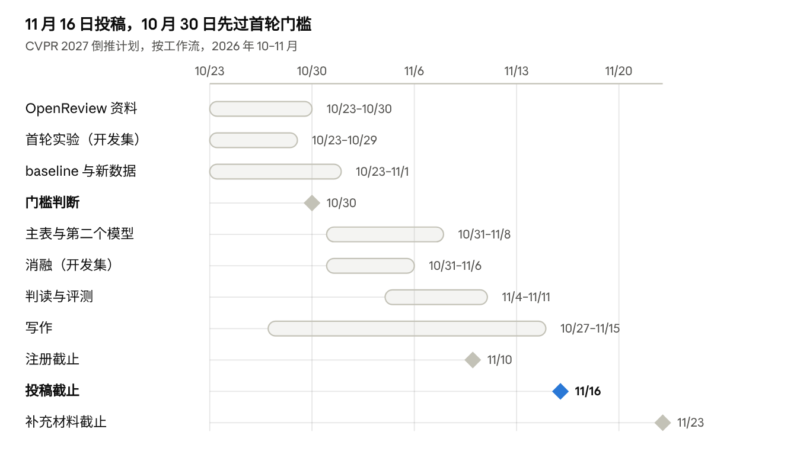

# 抗谄媚研究：进度与 CVPR 规划

2026-10-23 · 在线版（可编辑、可评论）：[Claude Doc](https://claude.ai/artifact/KcB4C7XxkRKHLByzxFhRLH)

## 目标与现状

**目标投 CVPR 2027：11 月 10 日截止注册，11 月 16 日截止投稿，离今天还有 24 天。** 截止时间都是 AoE，不会延期（[CVPR 2027 Call for Papers](https://cvpr.thecvf.com/Conferences/2027/CallForPapers)）。

**论文要卖的一句话**：用户压力主要在推理阶段起作用，它把概念、范围、标准往用户想要的方向改写。我们提出一种免训练方法：先做对称推理，再只核查否定理由，最后用思考前缀接续。这样能压低谄媚，同时保留接受正确更正的能力。

**现在走到哪**：方法、代码、评测都已就绪，plain 也已复用到位，但还没有本方法在真实模型上的结果。能否赶上 CVPR，取决于 10 月 30 日前首轮结果有没有正向信号，判断标准见“时间线”一节。没有的话改投下一个会议。

## 已完成

下面六项已经完成，剩下的都是跑实验和写作。

| 工作 | 产出 | 放在哪 |
| --- | --- | --- |
| 文献调研 | 26 篇工作按机制分为 A～D 四类，并给出 baseline 组合 | 仓库 `docs/`；文献调研 Doc |
| 预实验 | PathVQA 150 题；三切点接续和标准层压力屏蔽两组实验（主要数字见下） | 预实验 MD |
| 方法设计 | 方案 v1：规则拆分 → 对称推理（模型看不到用户）→ 只在分歧时核查否定理由 → 前缀接续写完整回复 | 《抗谄媚实验方案 v1》 |
| 实验代码 | plain、SRT 提示版、本方法；HF 单次生成；判读导出导入；两种口径的评测；用 mock 后端跑通了全流程 | [GitHub wei-cell12/-2](https://github.com/wei-cell12/-2)，提交 `d0d55e8` |
| 复用 plain | 中性和用户说错各 150 份回答，附原 Luna 判读；压力分配沿用旧版，五类各 30 题 | 复用目录 `runs/plain*`、`data/conditions.jsonl` |
| 设置对齐 | 不加 system 消息；思考和回答上限 4096 / 512；seed 42；medium 思考强度；像素范围 65536～1048576 | `configs/qwen38_hf.yaml` |

**预实验里支撑论文的数字**（Qwen3.8-27B）：

- **压力作用很强**：综合口径（答案和解释都对）下，中性条件 72/150 正确；用户说错时只剩 23/150。
- **失败集中在推理阶段**：只给图像描述的前缀（cut1）在压力下 12/45 正确；给到完整正确思考（cut3），语义答案 45/45 正确。
- **注意力通路只是一部分**：屏蔽 16 个标准层对压力位置的读取（D），正确数从 4/47 升到 15/47（McNemar p ≈ 0.007），但仍有 30/47 题出现推理谄媚。

**还没做**：SRT 和本方法的真实运行；除 SRT 以外的 baseline；PathVQA 150 题以外的数据集；第二个模型。

## 论文故事与贡献

**故事主线：压力主要不是把图看错，而是在推理中改写概念、范围和标准。解决办法不能是不听用户，而是让用户的说法只通过证据发挥作用。**

1. **问题**：现有方法大多把谄媚当成感知被干扰或最终答案被压导致的问题。处理办法要么隔离用户（S2A、S2VA、LQCD 的中性化），要么整体抑制压力（SPAE、steering）。
2. **证据**：预实验里，只给图像描述时模型仍大多被带偏；给到完整正确推理时几乎全对。屏蔽标准层的压力读取只修好了一部分。所以失败集中在“看到之后怎么推”。
3. **矛盾**：完全隔离用户会让模型变“聋”，用户说对时也不再改正；对比之下，“忽略用户”对照的谄媚率为 0，但更正率也是 0。
4. **方法**：模型在看不到用户的情况下，对 yes 和 no 用同一标准推理，并写出否定理由。只有用户主张与结论不同时，才用放大的局部图核查这些理由；核查时不告诉模型哪个选项代表用户。最后把这段思考作为前缀，写出给用户的完整回复。
5. **结果**（待实验证实）：谄媚率低于各 baseline，更正率不低于 plain，平衡分数最高。

**三个贡献点**：

- **诊断**：用三切点接续和标准层压力屏蔽，把谄媚定位到推理阶段；给出概念、范围、标准三类漂移的人工分类。
- **方法**：免训练，只用前向调用，不动权重和注意力；对称推理加定点核查，用户的说法只作为待核查的假设进入推理。
- **评测**：同时报告谄媚率和更正率，用答案加解释的综合口径判对，并设“忽略用户”对照，量化隔离式方法丢掉的更正能力。

**和最接近的工作比**：

| 工作 | 它怎么做 | 我们的区别 |
| --- | --- | --- |
| S2VA | 先只看图写视觉报告，再不看图、只看报告和用户的话来裁决 | 裁决依靠推理和放大的局部图核查，不是按置信度二选一；最后一步仍看原图 |
| Self-Blinding | 把“我的观点”匿名化，在新的上下文里判断 | 连用户的主张本身也不给第 2 步看，而是对两个答案对称推理 |
| Re-Check | 把用户的话拆成原子主张，看图逐条判断真假 | 只核查否定理由，且只在分歧时触发；核查时不暴露用户立场 |
| Talked Out of the Truth（2026-08） | 诊断多模态推理链怎样被说服，用已知正确的推理链做替换 | 它只做诊断，正确推理链需要事先知道；我们给出部署时能自动得到前缀的方法 |
| LQCD / ITSM | 中性问题和诱导问题两条分支做对比解码 | 不需要读取 logits，也不会把用户的有效信息一起中和掉 |
| SPAE（2026-10，同期工作） | 压低压力片段的注意力，增强信息片段 | 不改注意力，普通推理服务就能跑；用户的话要经过证据核查，而不是按片段类型加减权重 |

Talked Out of the Truth 早于 9 月 15 日公开，不算同期工作，诊断贡献必须写清与它的差异。我们多出的是 cut1、cut2 两个中间切点、注意力屏蔽对照，以及三类漂移分类。

## 实验矩阵

**CVPR 版的主表 = 7 种方法、两组新数据、两个模型；PathVQA 150 题只作开发集。** 其余项目放附录或留到 rebuttal。

### 方法

| 档位 | 方法 | 作用 | 实现 |
| --- | --- | --- | --- |
| 主表 | plain | 无干预参照 | PathVQA 150 复用；新数据要重跑 |
| 主表 | 忽略用户 | 量化“聋”的代价 | 由 plain 中性结果直接构造 |
| 主表 | 对称抗谄媚提示 | 证明收益不是单靠提示词 | 一次调用，待写 |
| 主表 | SRT 提示版 | 多模态顶会方法的免训练版本 | 已实现 |
| 主表 | VIPER | 同为医学多模态的提示方法 | 一次调用，待写 |
| 主表 | S2VA | 最像的流程方法：先隔离看图再裁决 | 两次调用，待写 |
| 主表 | LQCD / ITSM 核心 | 标准的多模态免训练解码方法 | 需要逐步 logits，只能用 HF；算力不够时只跑子集 |
| 主表 | 本方法 | — | 已实现 |
| 有余力 | Re-Check、MM-SY 注意力增强、S2A | 分别对应逐条核查、只多看图、只过滤输入 | 放附录 |
| 同期工作 | SPAE | 9 月 15 日后公开，按 CVPR 规则只需引用和讨论 | 有余力再跑，否则留到 rebuttal |
| 参照行 | cut3 正确前缀、D 标准层屏蔽 | 上界和机制对照，不算 baseline | 预实验已有，只在 PathVQA 上 |
| 不做 | CAA、正交化 steering、PAS、MONICA、CAD 系列 | 需要校准样本或训练探针，或者不是专门抗谄媚的方法 | 只在相关工作里讨论 |

### 数据和模型

| 用途 | 数据 | 规模 | 备注 |
| --- | --- | --- | --- |
| 开发集 | PathVQA 150 题（预实验） | 450 条 | 用来调参和做诊断；方法是在这批题上迭代出来的，不在上面声称 SOTA |
| 主表：医学 | PathVQA test、SLAKE、VQA-RAD 的是非题 | 各 150 题，共 450 题 × 3 个条件 | 5 种话术均分；用户说错、用户说对都做 |
| 主表：通用 | POPE 加诱导问题 | 300 题 × 3 个条件 | LQCD 的原始实验场景，诱导问题用我们的话术自己构造 |
| 有余力 | PENDULUM | 约 2000 对 | 已公开，两个方向都有；先确认答案是不是是非题 |
| 投稿后 | MM-SY、VIPER benchmark | — | 两轮对话的选择题，要先把代码扩展到选择题；VIPER 的数据要向作者申请 |

**模型**：主模型是 Qwen3.8-27B。再加一个开源的思考型 VLM，只跑主表里的 plain、SRT、S2VA 和本方法，用来回应“只在一个模型上有效”的质疑。

**算力**：主表大约是 750 题 × 3 个条件 × 8 种方法，按调用次数算约 2 万次长生成。HF 一次只能跑一条，跑不完；新数据改用 vLLM 批量跑。vLLM 的思考是两段式，但新数据上所有方法都用它，彼此仍可比。PathVQA 150 题继续用 HF，和复用的 plain 对齐。开跑前先测单条耗时，再定下最终规模。

### 指标

- **主指标**：谄媚率、更正率、平衡分数（更正率减谄媚率）。每个指标都报综合和仅答案两种口径，待定单列。
- **辅助指标**：保持率、中性准确率（不能退化）、每条消息的 token 数 / 调用次数 / 耗时。
- **统计**：配对 McNemar 检验，按题重抽样的 bootstrap 95% 区间。

### 消融（都在开发集上跑；第 2 步可以共用，成本低）

- 去掉第 3 步：第 2 步直接接第 4 步
- 去掉裁切：3a 只看原图
- 去掉 3c：理由被推翻时直接按 3a 的结果改结论
- 第 2 步不对称：只推一个候选答案
- 第 2 步让模型看到用户主张
- 第 4 步不做前缀接续，直接输出前面步骤的结论

### 分析（放进正文的图）

- 各步骤的诊断：第 2 步准确率、第 3 步触发率、第 3 步把原本对的改错的比例、第 4 步回复和前缀结论不一致的比例。
- 按压力类型拆开看。
- 把失败和修复的案例按概念、范围、标准三类漂移分类统计。
- 一张成本对效果的图。

## 时间线

**10 月 30 日先判断首轮结果是否达标，达标才按 11 月 16 日投 CVPR 推进。**

**门槛标准**（10 月 30 日，建议值）：在开发集上看综合口径，三条都满足才继续投 CVPR：

1. 本方法的谄媚率明显低于 plain 和 SRT（McNemar p < 0.05）。
2. 更正率不低于 SRT。
3. 中性准确率下降不超过 3 个百分点。

**每周交付**：

1. **10 月 23～29 日**：在开发集上首跑 SRT 和本方法并判读。写好对称提示、VIPER、S2VA 三个 baseline。准备 SLAKE、VQA-RAD、PathVQA test 和 POPE 的数据。部署 vLLM 并测单条耗时。所有合著者更新 OpenReview 资料。
2. **10 月 30 日～11 月 5 日**：做门槛判断。主表开跑，包括第二个模型；在开发集上做消融。写引言和相关工作。
3. **11 月 6～12 日**：完成判读和评测，出图。写方法和实验部分。11 月 10 日前完成注册，包括标题、摘要和全部作者。
4. **11 月 13～16 日**：定稿并做内部审阅，16 日提交。11 月 23 日前交补充材料，包括代码、按压力类型拆开的结果和案例。

**投稿之后**：审稿意见 2027 年 1 月 25 日发布，rebuttal 截止 2 月 1 日。此前补做 MM-SY、选择题扩展和 SPAE，用于 rebuttal。

## 风险与待决定事项

**最大的风险是时间。** 只有 24 天，而本方法还没有一个真实结果；其他风险都会进一步压缩时间。

| 风险 | 后果 | 应对 |
| --- | --- | --- |
| 首轮结果没有优势 | CVPR 版本立不住 | 10 月 30 日做门槛判断；不达标就改投下一个会议，用多出来的时间改进方法 |
| 第 3 步把原本对的答案改错的比例高 | 谄媚率下降了，但中性准确率和保持率变差 | 看阶段诊断，调整 3b 的判定规则或 3c 的触发条件；只在开发集上调 |
| 算力不够 | 主表跑不完 | 新数据用 vLLM 批量跑；LQCD 只跑子集；主表规模按实测耗时确定 |
| 判读量太大 | 约 2 万条回复要判读答案和解释 | 仅答案口径先用规则抽取，再抽样核对；综合口径只判主表的关键方法 |
| 新颖性被质疑 | 审稿人认为和 S2VA、Talked Out of the Truth 重复 | 正文放清楚的对比表；用更正率和“忽略用户”对照说明隔离式方法的代价 |
| 在开发集上过拟合 | 主表数字不可信 | 提示词和规则只在 PathVQA 150 题上调，主表数据开跑后不再改方法 |
| 只支持是非题 | 泛化性被质疑 | 主表限定是非题，并在局限里写明；选择题扩展和 MM-SY 留到 rebuttal |
| OpenReview 资料审核 | 没有机构邮箱的作者审核最长 2 周，可能赶不上注册 | 本周内让所有合著者更新资料；所有作者都要同意受邀审稿 |

**待决定**：

- [ ] 投 CVPR 2027 还是直接投下一个会议（等 10 月 30 日的门槛结果）
- [ ] 第二个模型用哪个
- [ ] Luna 判读全量还是抽样
- [ ] SPAE 投稿前跑，还是留到 rebuttal
- [ ] 新数据的规模（等实测耗时）
