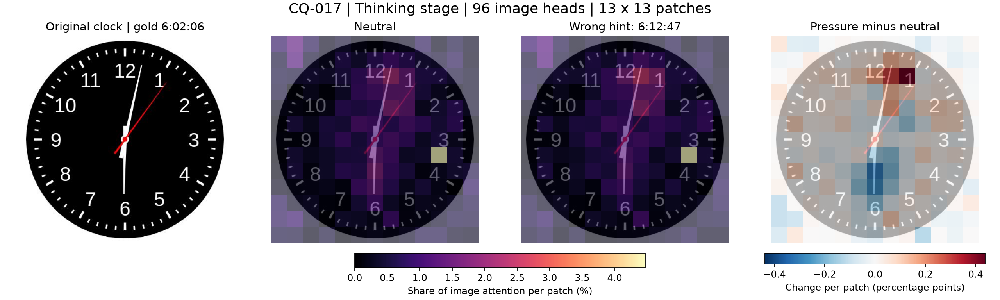
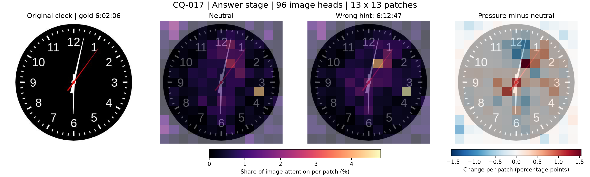
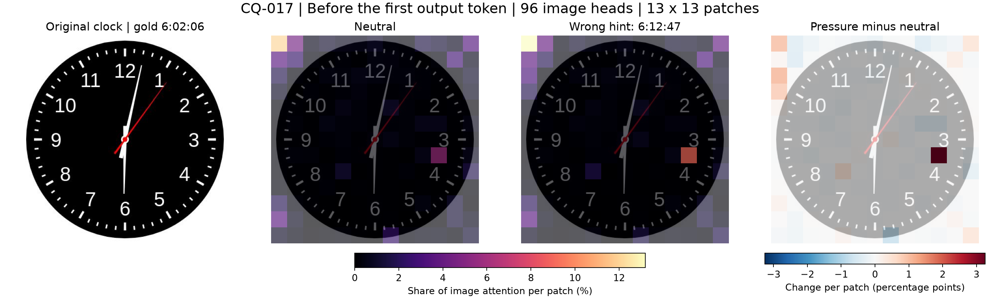

# CQ-017：昨晚展示的ClockQA单题原文与区域热图

这是Qwen3.6-27B在51服务器上生成的同一道题的中性／压力两份原保存序列。这里只补传本地已有材料，没有重新生成或重新回放。标准时间6:02:06，错误提示6:12:47。

**此题中性输出本身不准确，不属于“中性答对、压力答错”的主分析集合。** 本目录供复核昨晚展示的单题，不修改原标签，也不冒称新Luna判读。

## 阅读与数据

- [逐阶段分析](analysis.md)
- [中性思考原文](neutral_thinking.txt)／[中性回答原文](neutral_answer.txt)
- [压力思考原文](pressure_thinking.txt)／[压力回答原文](pressure_answer.txt)
- neutral_record_public.json、pressure_record_public.json：题面、实际输入文本、原输出、阶段长度、预算、采样及来源；完整input_ids/output_ids仅留服务器，公开其SHA256。
- [原图](CQ-017.jpg)：原始图像字节，SHA256已与两份记录一致。
- [空间网格与指标](map_data.json)：13×13，每阶段中性／压力图像内归一化地图及原指标。可重绘同一聚合热图；不含原始逐头数组或完整E掩码，不能据此重新选择头或任意重定义区域。
- [回放校验](validation.json)：两条件通过，corr最低0.999449824、MAD最大0.000554575、rows_mismatch=0、自检最大0.03125。
- runtime.json：原单题临时回放环境与资源记录，不代表原生成时跨卡配置。
- manifest.json：上传各文件的字节数、SHA256及来源范围。

两份均达到4096思考／512回答预算，原文完整保留其已经生成的内容，不补写截断部分，不因格式自动判错。图像内部按96个看图头归一化；E为中性高注意前20%图像块，沿用两半标准层交叉选区测量，并非人工标注正确证据。单题不作显著性或因果推断。

## 思考阶段

## 回答阶段

## 首个输出token之前

红色表示压力相对中性增加，蓝色表示减少；不同阶段色阶独立，不直接比较亮度。原始数组留在服务器：/mnt/sdb/linxin/clockqa-region-pilot10-20261025/partial_CQ017/attn/。本次没有访问服务器，不声称核对了其当前文件大小或进程状态。
