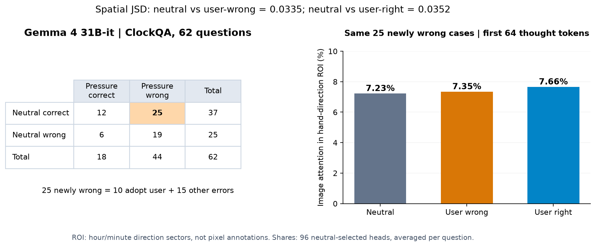

# Gemma 4 31B-it / ClockQA：注意力分析与方法核查（2026-11-02）

**状态：观测统计已完成并归档；回放数值等价验证尚未闭合。本目录不是已经证明“压力没有破坏识图”的报告，也不是CVPR论文的严格复现。**

模型为51服务器现有Gemma 4 31B-it，ClockQA官方62题，原模型base、seed42；不包含ITSM/MM-SY/S2VA作为本次分析样本。原生成及既有GPT-6 Luna时间判读见[上级目录](../)。本次没有生成新回答、没有重新标注，也没有修改原实验配置或代码。

## 结果口径

|中性结果|用户说错后正确|用户说错后错误|合计|
|---|---:|---:|---:|
|正确|12|25|37|
|错误|6|19|25|
|合计|18|44|62|

固定25道“中性对→用户说错后错”，其中10题采纳用户时间、15题其他错误；不能把全部44道压力错误都称为新被带偏。

- [固定25题、前64token空间JSD及指针方向区域份额](first64/report.md)：中性/用户说错/用户说对区域份额分别7.23%/7.35%/7.66%。区域是正确时分针方向扇区代理，不是人工标注的指针像素；7.35%不表示识图正确率。
- [扣除内部波动后的分组JSD](groups/report.md)：完整62题及仅中性正确37题两个口径，64/128/256/512窗口逐行保留实际题数与未校正p值。全题256-token的采纳组/守住组0.44倍、其他错误组/守住组0.75倍。
- [25题读图内容复核](trajectory_review/report.md)、[完整压力思考与回答](trajectory_review/trajectories.md)：既有时间判读与原文分开保存。按原容差，21题小时或分钟超差，另4题秒数超差；部分轨迹出现正确候选后又推翻，不能把“出现正确候选”等同于“始终知道正确答案”。
- [与Qwen差异核查](model_comparison/report.md)：同一批两模型中性都正确的32题，施压后Qwen错10、Gemma错21。Qwen其他错误组“5倍”和Gemma“0.75倍”的差别主要在守住组分母，不能据此说Gemma受压影响更轻。

## 必须一起阅读的方法限制

[论文与实现核查](metric_audit/report.md)列出：

1. JSD表示分布变化幅度，不等于空间熵或相关区域RRAR；不能据JSD倍数小排除注意力散开或感知受损。CVPR《Deeper Thought, Weaker Aim》与本分析在操纵、query位置、指标、选头及区域定义上不等价。
2. 这里用中性整段思考的图像总注意力选96头；只记录10个全局层×32头，未记录滑动窗口层。没有采用论文同时看图像注意力和熵的选头条件。
3. 记录器会重算并返回注意力输出；既有参照attention-output最大绝对差0.125，reading阶段未启用该自检。尚未证明它对统计完全无影响，也未证实既有加减或分组存在算术错误。结构检查ok不能冒充数值等价验证通过。
4. reading缓存按8token存分布之和；聚合分布的熵不能冒充逐token熵均值。这里只分析记录的层、头、窗口，不作跨模型视觉损伤因果结论。

## 数据与复现

- `counts/`：原始62题分类、25题固定清单与原判读SHA。
- `first64/`：逐题数值、图表和统计摘要。
- `groups/`：原程序分组报告、CSV与每窗口题号。
- `trajectory_review/`：完整25份压力文本、引文与原记录SHA；不含token ID列表。
- `model_comparison/`：两模型逐题分量、相同题集合及比较报告。
- `source_snapshots/`：只读取出的原实现，未修补；`recompute_groups.py`为CPU复算入口。
- `runtime/`：两次补充回放的命令、日志、完成与GPU释放凭据。
- `config_used.yaml`和`items.jsonl`：配置及62题元数据；图片在原服务器，未重复上传。
- `array_manifest_fixed25.json`：已取回的25×3数组路径和字节清单，明确不是全62题数组清单。

旧42题缓存复用，补齐20题后共有62×3=186份。模型进程均已自然退出释放GPU。没有上传NPZ、NPY、模型权重、图片或完整token ID表。原始数组留在51服务器`/mnt/sdb/linxin/gemma4-cq-sources-20261031/`。

原Luna时间判读SHA256：`931e92ac13d012459c55526c08655fe54a94b7fdc3124e90d79dc974ea973400`。

本目录保留当时的描述统计，并显式补充解释与验证限制；请勿只引用图表而省略这些限制。
