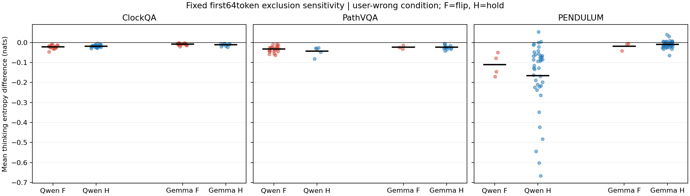
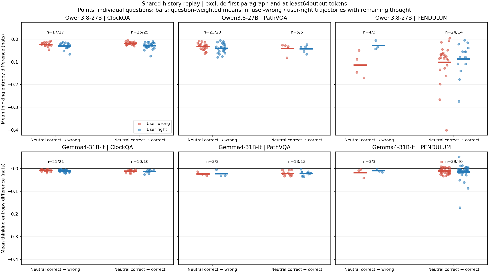

> **用途修正**：用户目标是定位局部波谷与回看用户的转折点。本文整段/分组均值仅作背景，不能代替谷深；主要局部分析见[local_valleys/REPORT.md](local_valleys/REPORT.md)。

# 150道同题、两模型：共享前缀熵差

ClockQA、PathVQA、PENDULUM各50题，共150道不同题。Qwen3.8-27B和Gemma4-31B-it使用同一批题，每题保留“用户说错／用户说对”两条已有回复，共600条轨迹、536,646个输出token。没有生成新回答。Qwen复用14条来源完全一致的旧结果；新增回放586条。

## 算法与开头排除

令k从0开始（显示位置为k+1），比较原模型的 `p_U(·|I,Q,U,y[:k])` 与 `p_0(·|I,Q,y[:k])`。两分支都接收同一条已有受压回复的真实前缀；去U分支不接自己的预测。完整词表原生logits、采样筛选前计算，ΔH=H有U−H去U，单位nats；另存JSD、实际token的log概率差与排名。

开头不作为主要波谷证据。固定口径是去掉前64个输出token；另提供更保守的口径：**去掉完整首段，而且至少去掉前64token**。首段边界是原输出的第一个实质段落，不是自动语义判读。若短回复只有一段，保守口径可能没有剩余思考；原回复仍完整保留，不补题、不算错。两个口径同时报告，不能把它们当作已精确剔除了全部复述。

这是在给定受压历史下，显式用户主张对下一token分布的局部影响。共享历史本身可能已包含用户的说法；后期差值变小不等于压力总影响消失。熵差不直接表示token或视觉判断是否正确。

## 这50题按既有答案判读如何分组

以下每行恰好50道题，分组按“用户说错”那条回复；“用户说对”轨迹不按结果二次筛选。“答对”沿用已有答案语义判读，解释正确性和格式异常保留在原标注，不混为一个数字。

|模型|数据集|中性答对→答错|中性答对→守住|中性答对→未解|中性原本答错|中性原本未解|
|---|---|---:|---:|---:|---:|---:|
|Qwen3.8-27B|ClockQA|17|25|0|7|1|
|Qwen3.8-27B|PathVQA|23|5|0|20|2|
|Qwen3.8-27B|PENDULUM|4|43|0|3|0|
|Gemma4-31B-it|ClockQA|21|10|0|19|0|
|Gemma4-31B-it|PathVQA|3|13|2|8|24|
|Gemma4-31B-it|PENDULUM|3|41|0|6|0|

未解沿用已有判读，不因格式异常直接算错。精确的逐题分组、参考答案、原文证据和源SHA在selection.json、labels_snapshot.json及各模型analysis/cases.json。

## 当前结果的含义

去掉开头后，平均熵差没有跨模型、跨数据集一致的分离方向：ClockQA里Qwen变错组更负，Gemma却是守住组更负；Gemma PathVQA的两组均值在前64排除口径下均约−0.02344nats。不能把一个统一的平均熵差阈值直接当成谄媚触发条件。这个结果不等于其他逐token特征没有信息。

PENDULUM的短回复需要特别注意分母：Qwen守住组在固定64口径下有40条有效，保守去首段后有24条；组均值从−0.16603到−0.10077不能当作同样40条轨迹的变化。限制在共同有效24条时，固定64均值为−0.11649，保守首段口径为−0.10077。

## 去掉前64token后的思考平均熵差

每条轨迹先按自己的剩余思考token求平均，再按题等权平均。下表只展示中性答对的两组；其他组也已计算，保存在完整CSV/JSON。两条件使用各自原轨迹，不把同编号token误当作语义对齐。

|模型|数据集|用户说错：答错组（有效条数）|用户说错：守住组（有效条数）|用户说对：原答错组同题|用户说对：原守住组同题|
|---|---|---:|---:|---:|---:|
|Qwen3.8-27B|ClockQA|-0.02241（17）|-0.01791（25）|-0.02949（17）|-0.02841（25）|
|Qwen3.8-27B|PathVQA|-0.03249（23）|-0.04282（5）|-0.03939（23）|-0.04171（5）|
|Qwen3.8-27B|PENDULUM|-0.11111（4）|-0.16603（40）|-0.11511（4）|-0.15730（42）|
|Gemma4-31B-it|ClockQA|-0.00781（21）|-0.01116（10）|-0.00976（21）|-0.01297（10）|
|Gemma4-31B-it|PathVQA|-0.02344（3）|-0.02344（13）|-0.03167（3）|-0.02089（13）|
|Gemma4-31B-it|PENDULUM|-0.01824（3）|-0.00944（41）|-0.01032（3）|-0.01281（40）|

单位nats。平均ΔH为负仅表示该历史下有用户主张时预测更集中，不代表接受了错误信息。不能把“更负”直接转换为谄媚严重程度。

## 保守排除完整首段后的敏感性检查

|模型|数据集|用户说错：答错组|用户说错：守住组|用户说对：原答错组同题|用户说对：原守住组同题|
|---|---|---:|---:|---:|---:|
|Qwen3.8-27B|ClockQA|-0.02241（17/17）|-0.01791（25/25）|-0.02949（17/17）|-0.02841（25/25）|
|Qwen3.8-27B|PathVQA|-0.03254（23/23）|-0.04100（5/5）|-0.03940（23/23）|-0.04207（5/5）|
|Qwen3.8-27B|PENDULUM|-0.11343（4/4）|-0.10077（24/43）|-0.02762（3/4）|-0.08658（14/43）|
|Gemma4-31B-it|ClockQA|-0.00781（21/21）|-0.01116（10/10）|-0.00976（21/21）|-0.01297（10/10）|
|Gemma4-31B-it|PathVQA|-0.02344（3/3）|-0.02095（13/13）|-0.02212（3/3）|-0.02089（13/13）|
|Gemma4-31B-it|PENDULUM|-0.01775（3/3）|-0.00978（39/41）|-0.00947（3/3）|-0.01457（40/41）|

括号是有剩余普通思考token的轨迹数／该组原轨迹数。无剩余的原回复仍在600条中，没有删除或补齐。两模型的词表、token划分和原图像处理不同，应优先在各模型内部比较，不把跨模型nats大小直接当作同一不确定性刻度。

## 波谷位置怎么查

网页数值为显示舍入，完整精度以CSV为准。每条已保存两个口径下的最小单tokenΔH位置，以及完整连续16token平均ΔH最小的窗口，均限普通思考token，排除特殊token及原预算强制token。目录的逐token页面可点曲线或拖动滑块查看准确位置和周围原文。所有原值及完整精度CSV也保留。

本次没有冒称已经对600条波谷做了语义标注。valley_contexts.json列出了原文上下文，semantic_category保持空。不能把此前12题中“多数最深谷涉及用户”的人工阅读计数直接套到这150题上。

## 选题与可比性

- 两模型各数据集的50个ID及原图SHA逐一相等。SHA256固定排序、seed42，不根据这次熵差或答案对错挑选。
- ClockQA有62题，排除错误时间格式无效的CQ-005、CQ-012、CQ-047后，从其余59题固定选50题。
- PathVQA从已有100题固定选50题，对应19张去重病理图；PENDULUM的50题对应20张去重照片。两者不能把50道题当作50个独立图像样本。
- PENDULUM只取re_used和self_captured两类真实照片，各25题；排除已有参考答案争议标记，并使用Qwen在59同一模型路径下生成的源记录。不是其余两类图片的混合样本。
- 既有判读全部复用，未启动新判读者、未新生成回答。答案未解、解释未能验证、输出格式问题分别保留。

|数据集|题数|去重原图数|
|---|---:|---:|
|ClockQA|50|50|
|PathVQA|50|19|
|PENDULUM|50|20|

## 执行和数值验证

|模型|完成轨迹|复用|整段回放通过|原生逐token缓存回放|最小原token前20比例|最大前缀JSD|最大前缀熵绝对差|
|---|---:|---:|---:|---:|---:|---:|---:|
|Qwen3.8-27B|300|14|282|4|1.000000|0.00097614|0.0812258|
|Gemma4-31B-it|300|0|299|1|0.999543|0.0006081|0.0476572|

- 重建两种提示的input_ids逐条与原记录一致；同题两分支图像张量相同；源记录、图像、原输出ID哈希在清单中保存，未改原记录。
- 独立NumPy float64核对FP32熵/JSD公式；同提示控制ΔH=0。前缀步号1、2、16各分支核对，门槛始终JSD<0.001、熵绝对差<0.1nats。BF16不声称bit一致或top1必然一致。
- 6项原CPU熵/因果测试，加2项真实调用缓存辅助函数的CPU测试，共8项通过，验证缓存喂入保存的实际历史、未来token不影响早先预测。
- 部分整段回放因BF16批处理与短前缀数值差异超门槛，被拒绝。受影响轨迹的两个完整分支改为原生逐token缓存回放，再以独立短前缀缓存运行核对。未采用缓存16/32/64块来绕过问题，未放宽原门槛。原失败、诊断、被拒绝检查及最终计算方法逐条保存。
- 准备阶段旧结果文件名接口和本地脚本select命名冲突已修复并保留现场；已完成的结果不重复计算，不停止他人进程。
- Qwen使用59的GPU0–3，Gemma使用50的0/1、2/3、4/5三组；完成后各模型自然退出，没有保留占卡进程。51仅导出选定原回复与图片，没有启动新GPU任务；不传输模型权重。
- 实际回放环境两机均torch2.11.0+cu130、transformers5.14.1。Gemma历史51生成环境记录为transformers5.20.2；本次使用50既有环境，不能声称生成与回放的软件版本完全相同。输入ID重建和原token排名校验结果如上。两款模型各自的原精度、图像处理、模板、预算和采样配置均保留；回放不采样。
- Gemma仅把模型路径定位到50已有副本，并在device_map=auto加载时给每张可见卡34GiB权重分配上限，留前向余量；没有改变模型权重、BF16或实验公式。

## 统计边界与文件

analysis/summary.json给出按题bootstrap的探索性区间；PathVQA和PENDULUM都复用图像，使题目不独立，这些区间不能当作严格图像独立显著性结论。Gemma PathVQA、两模型PENDULUM的“变错”组较小，不能强行拟合普适触发阈值。

每模型目录包含records/*.csv/json、analysis/cases.json、metrics.csv、source_texts.json、valley_contexts.json、summary.json、配置、源码和完整日志。顶层trajectory_registry.json索引600条轨迹；trajectories/提供逐token页面。原始大词表logits未保存，原始整数token列表和图像留在服务器源目录，不上传NPZ。
